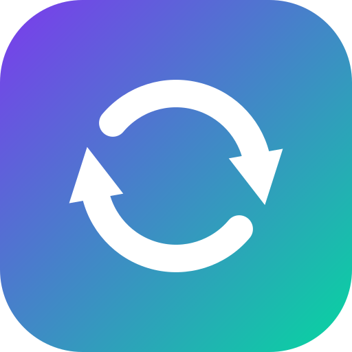

# Reclazz

**Free, open-source hot reload for Java, Spring and SAP Commerce.**
Edit, compile and see supported changes in the running JVM.

[Documentation](https://reclazz.com/docs/) · [Reload support](https://reclazz.com/docs/support-matrix/) · [Website](https://reclazz.com) · [Releases](https://github.com/onurkat/reclazz/releases)

## Why Reclazz?

- Reload method bodies and supported structural changes on stock JDKs, without a patched JVM.
- Refresh supported Spring beans, mappings, listeners and framework metadata.
- Keep SAP Commerce development moving with generated-class, configuration and resource integrations.
- Inspect applied, pending and failed changes through the IDE, build tools or MCP integrations.

Java 17+ is the target; acceptance evidence names exact JVM/framework combinations.
A JVM staying alive does not mean a recreated Spring bean keeps its mutable state.
Read the [conditions and limits](https://reclazz.com/docs/support-matrix/) for your change.

## Quick start

Choose the [Gradle, Maven, IntelliJ or standalone setup](https://reclazz.com/docs/quickstart/),
compile a small method edit, and check its changed behavior in the same JVM.
The [installation reference](docs/installation.md) contains the canonical commands
and version requirements; the website renders those same instructions.

## Documentation

The [documentation website](https://reclazz.com/docs/) is the reading destination.
Its pages are generated from this repository; edit the [source index](docs/index.md)
and its linked documents, then build the site. Do not maintain a second copy on `gh-pages`.

| Need | Start here |
|---|---|
| First working reload | [Quickstart](https://reclazz.com/docs/quickstart/) |
| Supported changes and restart requirements | [Reload matrix](https://reclazz.com/docs/support-matrix/) |
| Every option and detailed behavior | [Usage reference](https://reclazz.com/docs/reference/usage/) |
| AI tooling and MCP | [AI agent guide](https://reclazz.com/docs/reference/for-ai-agents/) |
| Diagnose a failed or partial reload | [Troubleshooting](https://reclazz.com/docs/troubleshooting/) |
| Full source documentation | [Reference library](https://reclazz.com/docs/reference/) |

## Contributing

Read [CONTRIBUTING.md](CONTRIBUTING.md), the [documentation workflow](docs/documentation-workflow.md)
and [SECURITY.md](SECURITY.md). Changes are recorded in [CHANGELOG.md](CHANGELOG.md).

## License and support

Source: [Apache 2.0](LICENSE). Name and mark: [trademark terms](TRADEMARK.md).
[Support development](https://github.com/sponsors/onurkat).
